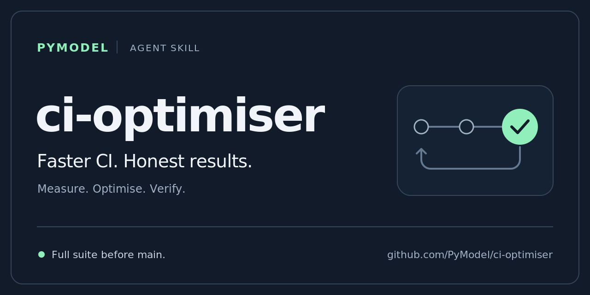

# 

[](https://skills.sh/pymodel/ci-optimiser)
[](https://github.com/PyModel/ci-optimiser/actions/workflows/release.yml)
[](https://github.com/PyModel/ci-optimiser/releases/latest)

An agent skill that makes CI faster without making it lie. It audits a repo's
push → trustworthy green → merge loop, measures where the time goes, and proposes one
reversible, benchmarked change at a time across seven modules: fast runners, native
lint/typecheck, bigger machines and test-worker reuse, caching and blobless clones,
parallel jobs, affected tasks, and pre-push hooks. It starts read-only and treats a
false green as worse than a slow build.

Before tuning runners, it designs four validation categories from the repository's
actual commands and policy: **code rules**, **change correctness**, **integrated main**,
and **release readiness**. Its default targets are PR p50 <120 seconds and p95 <180
seconds. The full suite runs in a merge queue before main; selection narrows PR
feedback only. It rejects retries, skipped tests and weaker checks as optimizations,
and ties releases to verified commits and artifacts.
For services it evaluates feature gates and progressive rollouts; for libraries and
other products it uses the appropriate compatibility, packaging and staging gates.
Detection produces evidence for agent review, not permission to remove checks.

## Contents

- [SKILL.md](skills/ci-optimiser/SKILL.md): the procedure agents follow.
- [Strict performance contract](skills/ci-optimiser/references/14-two-minute-ci.md): exact budgets, full queue execution, honest measurements, activation blockers and cost.
- [Current toolchain migration](skills/ci-optimiser/references/15-toolchain-migration.md): Bun, Oxlint, Oxfmt, TypeScript 7, tsrs and Vitest parity requirements.
- [references/](skills/ci-optimiser/references/): discovery matrix, playbook, safety rules, measurement, examples, dated sources, config recipes and [four-category validation architecture](skills/ci-optimiser/references/08-validation-architecture.md).
- [templates/](skills/ci-optimiser/templates/): audit report, optimization PR, paste-ready brief for agents without the skill.
- [scripts/](skills/ci-optimiser/scripts/): Python 3.10+ stdlib tools.
  - `discover_repo.py` inventories the stack and validation evidence, uses bounded regular-file reads, and refuses symlinks. Config fields can contain sensitive literals; keep raw evidence local.
  - `collect_gh.py` and `analyze_gh.py` pull read-only GitHub Actions data and produce p50/p95 baselines.
  - `benchmark.py` runs paired timing.
  - `select_affected.py` is a fail-closed affected-test selector.
  - [Measured adapters](skills/ci-optimiser/references/13-measured-adapters.md) add exact-revision
    GitHub check observations, artifact provenance verification, GitLab pipeline
    snapshots, cache inventory/economics, test shard planning, selector shadow
    comparison, and finite-capacity runner estimates. These are separate evidence
    types, not automatic release decisions.
- [evals/](skills/ci-optimiser/evals/README.md): independent behavior cases and grading protocol;
  included for maintainers, not evidence of executed model evaluations.

## Install

### Skills CLI

Install with the [skills.sh CLI](https://skills.sh/docs/cli) using Node.js 22.20 or later:

```bash
npx skills add PyModel/ci-optimiser --skill ci-optimiser
```

Choose your coding agents when prompted. The default installation is scoped to the
current project; add `--global` to make the skill available across projects. For a
project-scoped Codex installation:

```bash
npx skills add PyModel/ci-optimiser --skill ci-optimiser --agent codex
```

The complete package lives in `skills/ci-optimiser/`, with one `SKILL.md` entrypoint.
The installer keeps its `scripts/`, `references/`, `templates/`, tests, behavior cases
and MIT license together. The helper scripts require Python 3.10+.
The [skills.sh directory](https://skills.sh/pymodel/ci-optimiser) and badge use real
CLI install telemetry; listing and count updates can take time to appear.

### Manual clone and symlinks

Clone the canonical repository:

```bash
git clone https://github.com/PyModel/ci-optimiser.git
cd ci-optimiser
```

For an existing clone, update its origin URL:

```bash
git remote set-url origin https://github.com/PyModel/ci-optimiser.git
```

For an existing installation, inspect the old `agent-ci-optimizer` symlink and
confirm that it points to this checkout before removing that symlink. Then use the
new name below so agents discover one copy of the skill. Keep any real directory
and its contents until you have migrated it deliberately.

The skill directory name must be `ci-optimiser`. Check each target first with
`ls -ld <target>`. If an old entry exists, rename or remove it, then link with `ln -sn`:

```bash
SKILL_DIR="$PWD/skills/ci-optimiser"   # the complete package in this clone
ln -sn "$SKILL_DIR" ~/.agents/skills/ci-optimiser
ln -sn ../../.agents/skills/ci-optimiser ~/.claude/skills/ci-optimiser
ln -sn ~/.agents/skills/ci-optimiser ~/.codex/skills/ci-optimiser
ln -sn ~/.agents/skills/ci-optimiser ~/.pi/agent/skills/ci-optimiser
```

A symlink install serves this working tree as-is, so uncommitted edits reach every agent.
To export only the complete package, run
`git archive HEAD:skills/ci-optimiser | tar -x -C <dest>` into an existing destination.

## Run a timing audit in GitHub's cloud

After the `CI timing audit` workflow is merged to the default branch, open
**Actions → CI timing audit → Run workflow** and select the default branch.
It uses this repository's built-in read-only `GITHUB_TOKEN`; no extra secret,
CloudBees account or runner installation is needed. It executes the deterministic
Python collector and analyzer, not an LLM agent. It cannot edit the repository.

The manual workflow samples the last 150 retained runs across all outcomes,
including incomplete runs, and collects available attempt history. It publishes
job waiting/setup/running p50 and p95 diagnostics in the run summary and a
one-day report/JSON artifact. Published JSON allows only timing fields, bounded
workflow/job labels and outcome counts; it excludes step names (which can contain
shell commands), branch metadata, raw API snapshots, logs and arbitrary extra fields.
Deleted/expired history remains unknown. The collector caps
attempt history at 100 per run; missing jobs, attempts or source identity fail
collection. Unknown/censored timings remain visible instead of becoming zeros.

**Protection and security/merge eligibility are not assessed.** The explicit
`collect_gh.py --timings-only` scope avoids administration-only protection reads;
the normal full audit still fails when required protection evidence is unavailable.
This workflow must not become a required merge check. Its green result confirms
the requested timing sample was collected, not that historical builds passed or
the PR speed target was met. It does not change the full-suite `ci` workflow.

Collection gets 180 seconds, analysis 10, report generation 5, summary output 2,
artifact upload 1 minute, and the job 5 minutes total. Collection uses zero retries
and a 10-second request timeout; workflow re-runs are rejected. These are bounds
for a manual history audit, not measurements of PR feedback. Standard GitHub-hosted
compute is free for this public repository; report artifacts use the account's
shared storage allowance. The one-day retention limits that usage.

## Test

```bash
python3 .github/run_repository_tests.py    # full bundle + repository release policy
actionlint                                # repository workflow lint
```

For an installed copy, run `python3 -m unittest discover -s tests -v` from its
`ci-optimiser` directory. Its self-tests do not require repository-only CI or README files.

## Automated releases

[Release Please](https://github.com/googleapis/release-please-action) maintains a
version and changelog PR after successful first-attempt `main` CI, using the same
built-in-token approach as [Jev Judge MCP](https://github.com/PyModel/jev-judge-mcp).
The existing `v0.1.0` tag and release remain unchanged. Use Conventional Commit
squash titles such as `fix: reject incomplete timing evidence` or
`feat: add a provider adapter`; plain descriptive history is not inferred as release notes.

Review the bot PR, select **Approve workflows to run** when GitHub requests it,
then use the normal full-suite merge queue. The bot creates a draft release.
Publication requires the exact current-main commit, complete green CI jobs and
steps on attempt 1, matching version/tag metadata, and a passing standalone skill
suite. It publishes source releases; it does not require a package registry.

One repository setting is required: **Settings → Actions → General → Workflow
permissions → Allow GitHub Actions to create and approve pull requests**. The
workflow itself never approves or merges a PR. No additional account, PAT, App
secret or paid runner service is needed. Read the
[release automation guide](docs/release-automation.md) for activation, versioning,
failure handling, bounds and the precise publication guarantees.

## Local pre-push hook

The executable `.githooks/pre-push` enforces a strict nine-second budget. It checks
the actual pushed diff for whitespace errors, compiles changed Python commit blobs
for syntax errors, runs the packaging and feature-register contracts, and runs
`actionlint` when workflows change. Install the reviewed actionlint version before
pushing workflow changes; missing tools fail the hook.

Inspect `git config --show-origin --get core.hooksPath` and the active hooks
directory first. If existing hooks are active, integrate this hook through their
manager so none are disabled. Otherwise enable it for this clone:

```bash
git config --local core.hooksPath .githooks
test -x .githooks/pre-push
```

Push a clean, committed HEAD. The hook supports new branches, force updates, and
multiple destination branches at that HEAD; it rejects unavailable bases, other
candidate revisions and tags. Deletion-only pushes explicitly report that no
source candidate exists. Python syntax compilation is not static typechecking;
this stdlib repository has no configured formatter or static typechecker. Full CI
remains required because local hooks cannot govern GitHub API writes.

© 2026 PyModel LLC. MIT [license](LICENSE).
